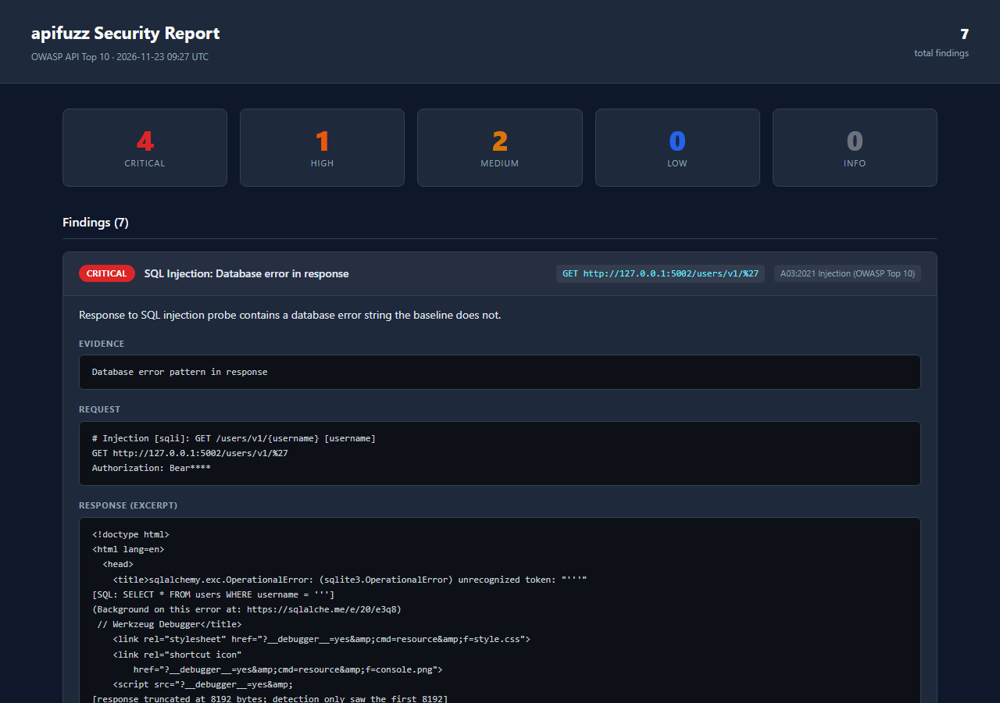

# apifuzz

**An OWASP API Top 10 scanner driven by your API description.** Give it an OpenAPI/Swagger file, a HAR
recording or a Postman collection plus the base URL of an API you are allowed to test. It generates security
test cases from the schema (field names, types, which endpoints need auth), sends them, compares each answer
with a normal authenticated request, and reports findings as JSON, SARIF (GitHub code scanning) or a
self-contained HTML report.

!!! warning "Authorized use only"
    apifuzz sends attack payloads (injection, SSRF, auth bypass, request bursts). Only scan APIs you own or
    have explicit written permission to test.

<small>HTML report from an authenticated scan of [VAmPI](https://github.com/erev0s/VAmPI) (rate-limit findings
trimmed to one for space). Credentials in the request are masked.</small>

## What it finds

Twelve checks, mapped to 8 of the 10 [OWASP API Security Top 10 (2023)](https://owasp.org/API-Security/editions/2023/en/0x11-t10/)
categories, plus injection (which has no API 2023 category and is reported as OWASP Top 10 A03:2021):

| OWASP category | Checks |
|---|---|
| API1 Broken Object Level Authorization | [`bola`](checks/bola.md): user B reading or changing user A's objects (`--second-token`), ID enumeration |
| API2 Broken Authentication | [`auth`](checks/auth.md): no/invalid/empty credentials, JWT `alg:none`, unverified signature, `kid` traversal, weak HS256 key; [`user_enum`](checks/user-enum.md): login answers differ for existing users |
| API3 Broken Object Property Level Authorization | [`mass_assignment`](checks/mass-assignment.md): privileged fields stored; [`data_exposure`](checks/data-exposure.md): secrets and undocumented fields in responses |
| API4 Unrestricted Resource Consumption | [`rate_limit`](checks/rate-limit.md): 50-request bursts; [`redos`](checks/redos.md): regex backtracking (opt-in) |
| API5 Broken Function Level Authorization | [`bfla`](checks/bfla.md): privileged operations called with `--low-priv-token` |
| API7 Server Side Request Forgery | [`ssrf`](checks/ssrf.md): metadata/internal URLs in URL-like parameters, blind probes with `--oob-url` |
| API8 Security Misconfiguration | [`cors`](checks/cors.md): origin reflected with credentials allowed |
| API9 Improper Inventory Management | [`inventory`](checks/inventory.md): exposed `.env`, actuator, metrics, shadow specs, neighbouring API versions |
| A03:2021 Injection | [`injection`](checks/injection.md): SQLi (error, boolean, time), NoSQLi, SSTI, command injection, reflected XSS |

API6 (sensitive business flows) and API10 (unsafe consumption of APIs) are not tested.

## Firm and tentative findings

Every finding carries a confidence. **Firm** means a comparison confirmed it: the probe's response matched the
authenticated baseline request, user B got back user A's object, a follow-up `GET` showed injected values were
stored, or a true/false pair answered differently. **Tentative** is a plausible signal that needs a person to
verify it (for example a `204` with no body after a cross-user `PUT`). Tentative findings are SARIF `note`s
under a separate `<rule>/tentative` rule capped at medium security-severity, so they don't fail GitHub's
default check, and `--min-confidence firm` hides them. See [How it works](how-it-works.md#firm-and-tentative).

## Measured, with disclosures

apifuzz is scored against each target's own list of documented vulnerabilities. On VAmPI it detects 7 of 9
documented vulnerabilities by default (8 of 9 with `--time-based`) with 0 false positives on both the
vulnerable and the secure build; on OWASP crAPI, measured once before any tuning, it detected 5 of 18 documented
challenges. Rules changed after seeing benchmark output are listed. Details and the after-tuning numbers:
[Benchmarks](benchmarks.md).

## Where to go next

- [Quickstart](quickstart.md): install from source, run a first scan, read the report.
- [How it works](how-it-works.md): the pipeline, baselines and scan passes.
- [Safety and scope](safety.md): what a scan sends and writes, and how to limit it.
- [CLI reference](reference/cli.md) and [Output formats](reference/output.md).
- [CI integration](ci.md): GitHub code scanning, GitLab, `--fail-on`, accepted findings.
- [Comparison and limitations](comparison.md): what apifuzz does not do.
- Source: [github.com/dragonday3/apifuzz](https://github.com/dragonday3/apifuzz) (MIT).
